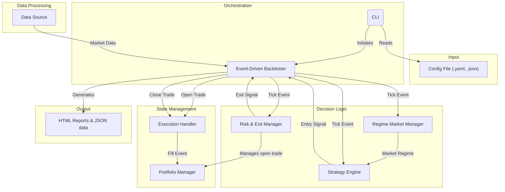

# Modular Trading & Backtesting Platform


**40,000 lines of production Python. 1,953 automated tests. 91.89% coverage. Built in 6 months by one engineer working with Claude Code.**

A high-performance event-driven backtesting and trading platform with declarative YAML strategies, pluggable risk management, regime-based market analysis, and a full ML research pipeline (LightGBM signal generation, walk-forward validation, Monte Carlo simulation).

This repo is also a demonstration of **AI-collaborative development** — not "AI wrote my code" and not "I supervised AI." A methodology: I define problems with precision, give Claude full context (architecture, constraints, edge cases, what "right" looks like), evaluate proposed solutions against what I know about correctness, make the judgment calls, and validate obsessively. Production-quality software at a velocity I couldn't reach alone.

**Quality infrastructure:** TDD mandate across all features. GitHub Actions CI with ruff linting, mypy type checking, enforced coverage, and SonarCloud analysis. Pre-commit hooks enforcing architecture boundaries, import structure, and style. DVC for data and model versioning against an S3 remote.

## Core Features

- **Event-Driven Backtester**: Simulates trading strategies with high fidelity, processing market data minute-by-minute to avoid lookahead bias.
- **Declarative Strategy Engine**: Define complex trading logic in simple, readable YAML files. Strategies are completely decoupled from risk management.
- **Pluggable Risk & Exit Management (REM)**: Define exit logic (stop-losses, take-profits) separately from entry signals, allowing for mix-and-match testing of risk models.
- **Regime-Based Market Analysis (RMM)**: Classify market conditions (e.g., "trending," "ranging") and dynamically enable or disable strategies based on the prevailing regime.
- **Comprehensive Reporting**: Automatically generates detailed HTML reports, `brief.json` summaries, and trade logs for each backtest.
- **AI/ML Research Lab**: A dedicated module for experimenting with machine learning models for signal generation and market analysis.
- **Meta-Campaign System**: Automate campaign generation for comprehensive ML model training across multiple parameters, instruments, and timeframes.

## Architecture

The platform is built on a foundation of clean architecture and **separation of concerns**. The diagram below illustrates the high-level system architecture and the flow of information between components. A more detailed breakdown is available in the [System Architecture documentation](docs/architecture.md).

Backtester-specific documentation lives in `docs/architecture/backtester/`:
- [Overview](docs/architecture/backtester/overview.md) — module-by-module responsibilities.
- [Architecture & sequencing](docs/architecture/backtester/architecture.md) — diagrams and event flows.
- [Principles & requirements](docs/architecture/backtester/principles.md) — the behavioral contract the code must satisfy.
- [Benchmarks](docs/architecture/backtester/benchmarks.md) — current performance metrics with reproduction commands.
- [Runbook](docs/architecture/backtester/runbook.md) — validation steps, telemetry, and known follow-ups.



The most critical design principle is the strict separation of the **Strategy Engine** from the **Risk & Exit Manager (REM)**. This decoupling allows for immense flexibility, where any strategy can be tested against any risk management model.

## Technology Stack

- **Language**: Python (3.12+)
- **Dependency Management**: Poetry
- **Core Libraries**: pandas, NumPy, Pyarrow
- **Technical Analysis**: ta (0.11.0), TA-Lib (0.6.7)
- **API & Web**: FastAPI, Uvicorn
- **Data Validation**: Pydantic
- **ML & Research**: scikit-learn, LightGBM, SHAP, MLflow
- **Testing**: Pytest, pytest-bdd, Coverage.py
- **Linting & Formatting**: Ruff, MyPy

## Installation

#### Prerequisites
- Python (version 3.12 or higher)
- [Poetry](https://python-poetry.org/docs/#installation)
- TA-Lib C library (for technical indicators)

#### Steps
1.  **Clone the repository:**
    ```bash
    git clone <your-repository-url>
    ```
2.  **Navigate to the project directory:**
    ```bash
    cd trading-platform
    ```
3.  **Install TA-Lib C library** (system dependency):
    - **macOS:**
      ```bash
      brew install ta-lib
      ```
    - **Ubuntu/Debian:**
      ```bash
      sudo apt-get install ta-lib
      ```
    - **Windows:**
      Download pre-built binaries from [https://github.com/cgohlke/talib-build/releases](https://github.com/cgohlke/talib-build/releases)
4.  **Install Python dependencies:**
    ```bash
    poetry install
    ```
    This will install all Python packages including the TA-Lib wrapper.
5.  **Verify the installation by running the test suite:**
    ```bash
    poetry run pytest
    ```
    All tests should pass, confirming the environment is set up correctly.

## Quickstart

1.  **Run a demo backtest:**
    ```bash
    poetry run tp run-backtest --demo
    ```
    This will run a pre-configured backtest and output the results to the `runs/` directory.

2.  **Compare two backtest results:**
    ```bash
    poetry run tp compare path/to/run_A/brief.json path/to/run_B/brief.json
    ```

## Validation & Reporting

- `poetry run pytest tests/backtester -q` runs the fast unit suite for the event loop, context builders, and reporting pipeline.
- `poetry run pytest tests/validation -k "export_exit_price or strategy_validation" -q` compares our platform trades against the TradingView reference datasets (exit prices, exit times, MFE/MAE). These tests **must pass** before releasing any change.
- The hash-based tests in `tests/validation/test_strategy_validation.py` intentionally fail at the moment because the engine records higher precision stop prices than the frozen CSVs. Do not regenerate the goldens yet—the failures remind us to bless the new output once stakeholders finish their review.

Every run produces a telemetry log entry with bars/sec, fills, and brief-generation timing. Enable additional logging with `REPORTING_TELEMETRY=1` to capture `brief_seconds` and `trade_count` for post-run analysis. The reporting pipeline lives in [`src/trading_platform/backtester/reporting_pipeline.py`](src/trading_platform/backtester/reporting_pipeline.py).

## CLI Commands

The platform provides a comprehensive CLI (`tp`) for all operations:

### Research & Campaign Management
- `tp meta-campaign-plan` - Generate campaign configurations from a meta-campaign file
  - `--config` - Path to meta-campaign.yaml file
  - `--output-dir` - Directory to write generated configs (default: config/campaigns/generated/)
  - `--force` - Overwrite existing files
  - See [Meta-Campaign System Guide](docs/user_guides/meta_campaign_system.md) for details

- `tp campaign-run` - Execute campaign runs
- `tp campaign-review` - Generate campaign review report
- `tp campaign-publish` - Publish campaign dataset to master trade log

### Data Validation
- `tp validate-data` - Validate data integrity for historical price data
  - `--data-dir` - Directory containing parquet files (required)
  - `--instruments` - Specific instruments to check (default: all)

### ML Model Training
- `tp train-profitability-models` - Train profitability models from enriched trade data
- `tp train-diagnostic-models` - Train diagnostic models for regime analysis
- `tp predict-profitability` - Predict profitability for trades using trained models
- `tp analyze-regime` - Analyze regime performance using diagnostic models

### Backtesting
- `tp run-backtest` - Run backtest and write artifacts
  - `--config` - Path to JSON/YAML RunConfig
  - `--demo` - Use demo backtest
- `tp compare` - Compare briefs and write HTML report

For a complete list of commands, run `tp --help` or see the [user guides](docs/user_guides/).

## Development & Quality

- **Run tests:**
  ```bash
  poetry run pytest
  ```
- **Run linter and type checker:**
  ```bash
  poetry run ruff check . && poetry run mypy .
  ```
- **Generate coverage report:**
  ```bash
  poetry run pytest --cov=trading_platform --cov-report=html
  ```
