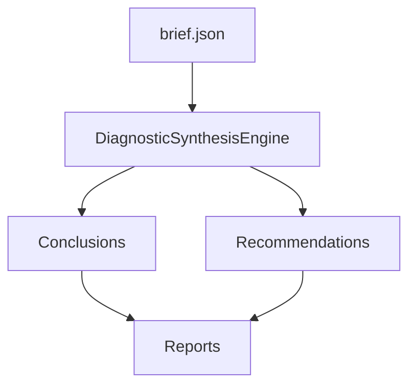

# AI Module Architecture

## Overview

The AI module provides automated diagnostics and recommendations for trading strategies based on backtest briefs and model outputs. It is designed to be modular, extensible, and fully integrated with the CLI pipeline.

## CLI Command: `ai-diagnose`

- Entry point for AI diagnostics.
- Consumes a `brief.json` file containing backtest results and metadata.
- Runs the `DiagnosticSynthesisEngine` to produce conclusions and recommendations.
- Outputs human-readable and machine-readable reports.

## DiagnosticSynthesisEngine

- Central class for orchestrating rule evaluation and recommendation generation.
- Accepts the full brief as input.
- Applies all diagnostic rules (see `BaseDiagnosticRule` implementations).
- Synthesizes findings into conclusions and recommendations.
- Exposes methods to generate Markdown and JSON reports.

## Rule-Based System

- Each diagnostic rule inherits from `BaseDiagnosticRule`.
- Rules evaluate specific sections of the brief and return `DiagnosticConclusion` objects if triggered.
- All rules are registered via `get_all_rules()`.

## Data Flow Diagram

## Extensibility

- New rules can be added by subclassing `BaseDiagnosticRule`.
- Recommendations logic is centralized in `ai/synthesis/recommendations.py`.
- Reports are generated via engine methods for Markdown and JSON output.
