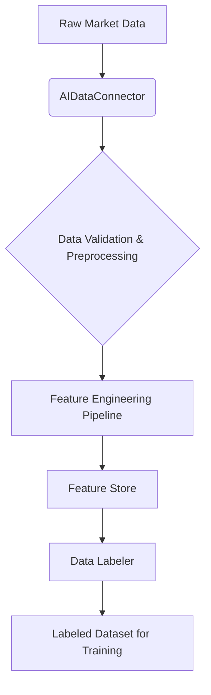

# AI Module: Data Flow and Processing Logic

This document outlines the data flow and processing logic within the AI module, from raw data ingestion to feature engineering and data labeling.

## 1. Data Ingestion and Connectors

- **Source:** Raw historical market data (e.g., CSV files from Dukascopy, OANDA live stream).
- **Component:** `src/trading_platform/ai/data_connectors.py` (`AIDataConnector`).
- **Process:**
    1.  Retrieves historical data from the `DataCatalog`.
    2.  Performs initial data validation (e.g., schema adherence, missing values).
    3.  Ensures data lineage tracking.

## 2. Feature Engineering

- **Source:** Raw or pre-processed market data from data connectors.
- **Component:** `src/trading_platform/ai/feature_engineering/pipeline.py` and `feature_store.py`.
- **Process:**
    1.  Generates comprehensive feature sets from input data.
    2.  Handles scaling, normalization, and other preprocessing steps.
    3.  Manages feature versioning to ensure reproducibility.
    4.  Stores processed features in the `FeatureStore`.

## 3. Data Labeling

- **Source:** Processed features and raw market data.
- **Component:** `src/trading_platform/ai/data_labeling.py` (`DataLabeler`).
- **Process:**
    1.  Generates target variables for model training (e.g., future price direction).
    2.  Applies logic to prevent look-ahead bias.
    3.  Tracks labeling methodology versions for reproducibility.

## 4. Data Flow Diagram (Conceptual)

## 5. Data Contracts and Formats

- **Raw Data:** Typically Pandas DataFrames with `timestamp`, `open`, `high`, `low`, `close`, `volume`.
- **Features:** Pandas DataFrames with various technical indicators and derived features.
- **Labels:** Pandas Series or DataFrame column indicating the target variable (e.g., `1` for long, `-1` for short, `0` for flat).

## 6. Future Considerations

- Integration with real-time data streams for live feature generation.
- Advanced data validation and anomaly detection.
- Automated feature selection and engineering.