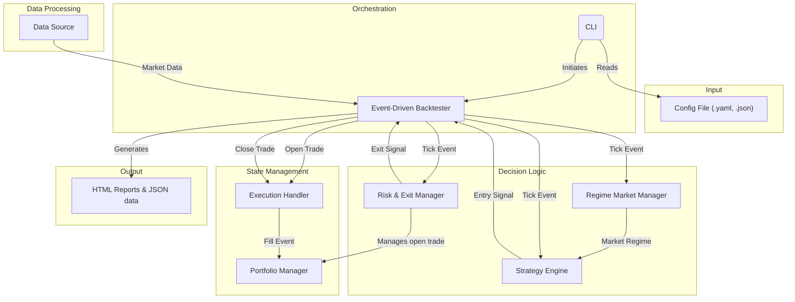

# System Architecture

This document provides a high-level overview of the trading platform's architecture. The diagram illustrates the main components and their interactions during a typical backtest execution.

## Component Descriptions

-   **CLI**: The command-line interface provides the entry point for user commands, such as `run-backtest`.
-   **Config File**: A YAML or JSON file that defines all parameters for a run, including the strategy, risk management rules, and data settings.
-   **Data Source**: Provides historical market data (e.g., from Parquet files) to the backtester.
-   **Backtester**: The core orchestrator. It processes data tick-by-tick in a time-series loop, feeding market data to all other components.
-   **Regime Market Manager (RMM)**: Analyzes market conditions to determine the current "regime" (e.g., Trending, Ranging).
-   **Strategy Engine**: Generates trade entry signals based on indicator calculations and the current market regime.
-   **Risk & Exit Manager (REM)**: Manages the lifecycle of an open trade, applying rules like stop-losses or take-profits.
-   **Execution Handler**: Simulates trade execution, including fills and costs.
-   **Portfolio Manager**: Tracks the state of the trading account, including positions, equity, and performance metrics.
-   **Reports**: Generates output files, including detailed HTML reports and structured JSON data for analysis.
