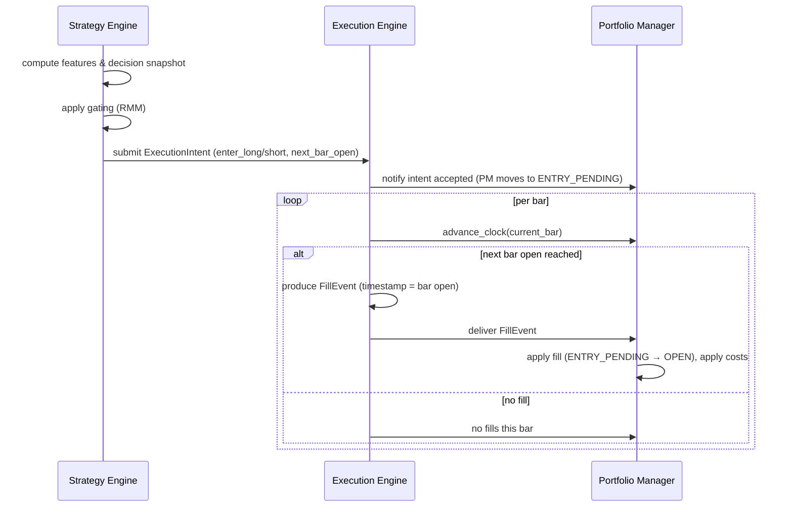
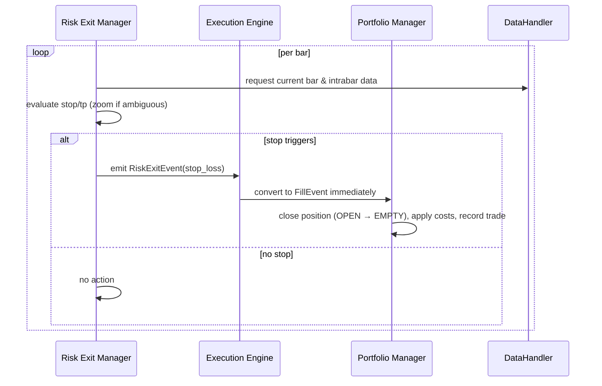
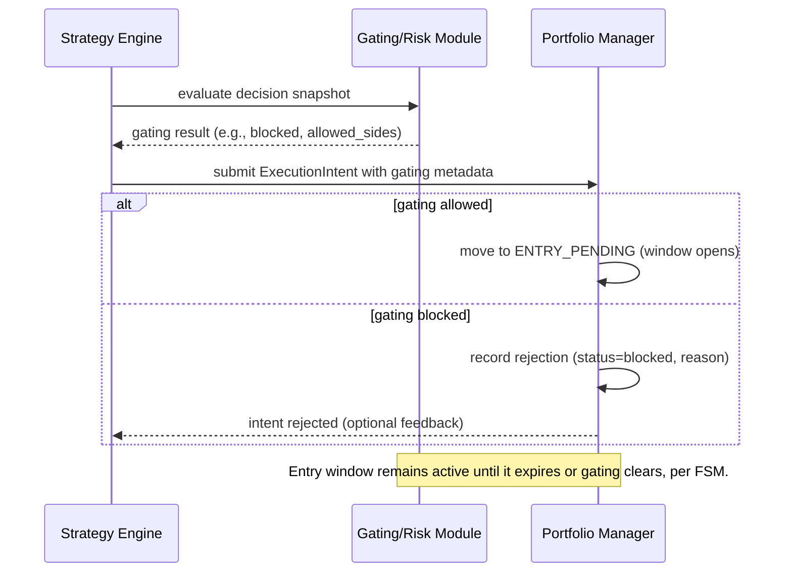

# Backtester Rewrite Architecture Notes

## Component Diagram
```mermaid
graph LR
    DH[DataHandler (session-aware bars)] --> STR[Strategy Engine & features]
    STR --> SNAP[DecisionSnapshot]
    SNAP --> INTENTS[ExecutionIntent Queue]
    INTENTS --> EE[Execution Engine]
    EE -->|FillEvents| PM[Portfolio Manager (FSM + CostModel)]
    SNAP --> REM[Risk Exit Manager]
    REM -->|RiskExitEvents| EE
    PM --> RPT[Reporting/Briefs]
    PM --> VAL[Validation/Diagnostics]
```

**Component responsibilities**
- **DataHandler:** supplies bars with explicit `open_time`/`close_time`, handles resampling and feature cache alignment.
- **Strategy Engine:** computes strategy/global features, evaluates entry/exit rules, emits `DecisionSnapshot`s (with risk/gating metadata) plus `ExecutionIntent`s.
- **Execution Engine:** accepts intents/risk events, advances with the authoritative clock, and produces `FillEvent`s according to the execution model (initially `next_bar_open` only).
- **Risk Exit Manager:** evaluates stop/take-profit/trailing rules per bar (with intrabar zoom when required) and emits `RiskExitEvent`s that bypass deferred execution.
- **Portfolio Manager:** maintains per-position FSMs, enforces gating/limits, applies all trading costs, records trades, and feeds reporting/validation layers.
- **Reporting/Validation:** consume the trades, contexts, and telemetry for briefs, diagnostics, and golden comparisons.

## Sequence Diagrams

### Next-Bar-Open Entry Flow


### Intrabar Stop Detection Flow


### Gating Rejection Flow

